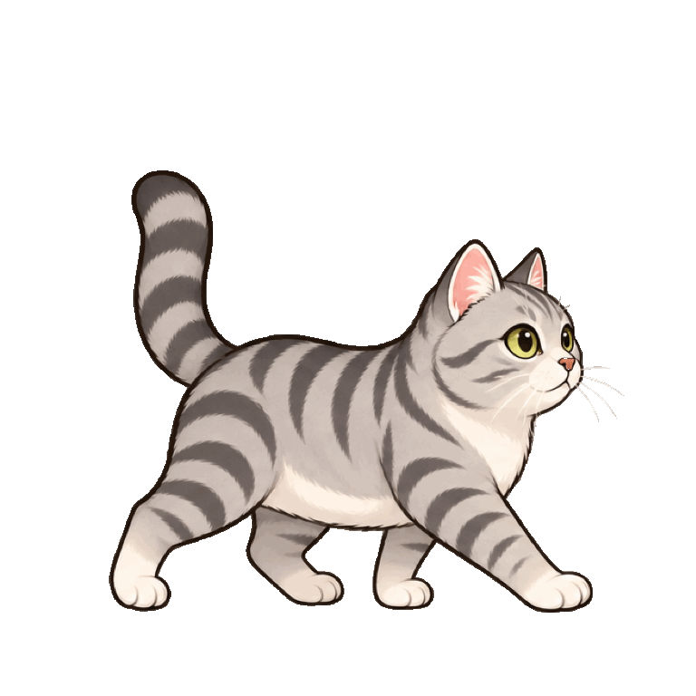
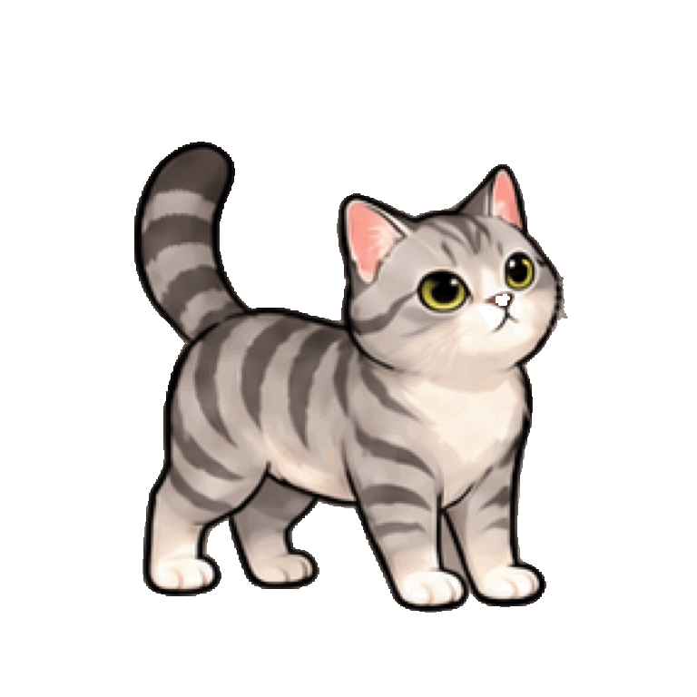
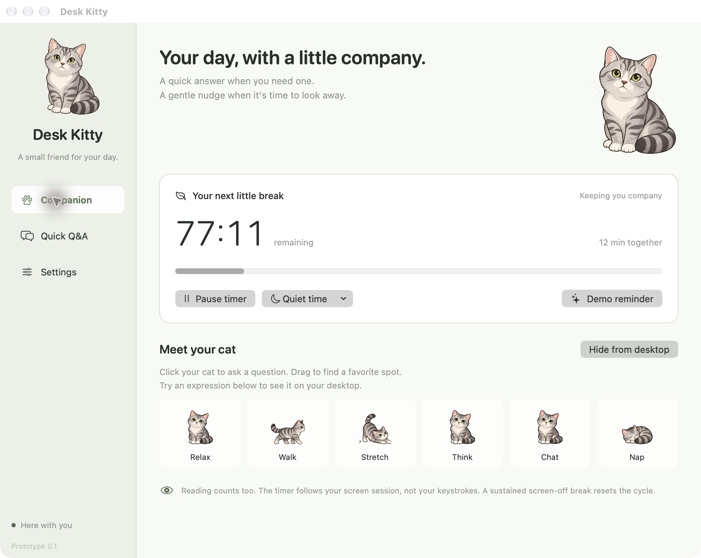
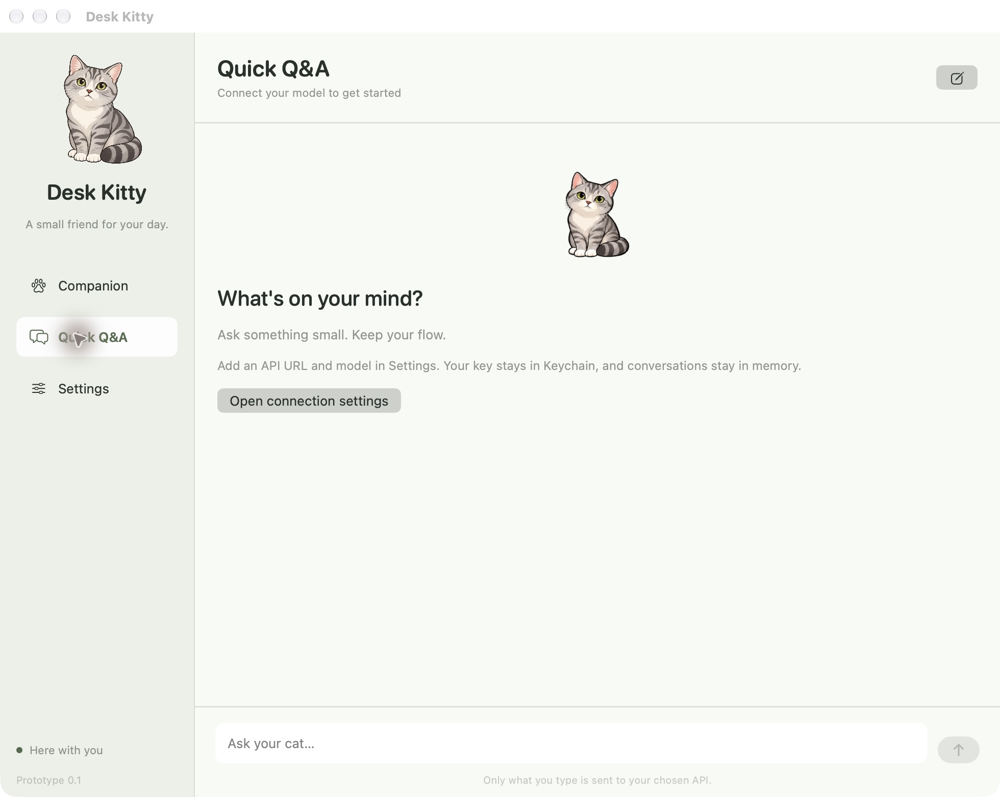
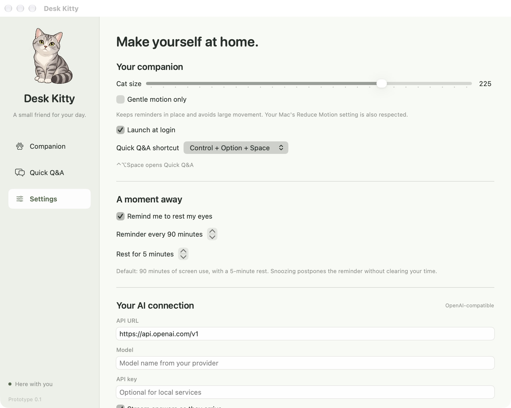

# chubby-cat

A native macOS desktop cat with quick AI Q&A and gentle screen-break reminders. The silver tabby character is based on the user's reference photos.


## Preview

The cat now blinks at a calmer pace, occasionally looks around, stretches and naps. Walking follows actual distance, including the slower return from a reminder. Dragging, chat and rest take priority over ambient poses.

 

These are previews of the exported frames; the desktop app drives walking by distance and plays the stretch once. [All six action previews and export details](docs/cat-animation-design.md#cat-3-runtime-update).

The companion dashboard brings together the screen-break timer, quiet-time controls and six animation previews. **Demo reminder** lets you try the center-screen walk, stretch and return without waiting 90 minutes.



Quick Q&A — ask your cat a question

Click the desktop cat or use the global shortcut to open Quick Q&A. This screenshot shows the first-run screen before connecting an API; add your provider and model in Settings to start chatting.




Settings — companion, breaks and API connection

Adjust the cat's size, motion, startup and shortcut preferences, then set the reminder interval and connect your own compatible API.




Interface screenshots are captured from the running macOS prototype. Shown preferences and remaining time are illustrative of that session.

## Run the prototype

The current channel is a **self-distributed preview** outside the Mac App Store. Packaging this preview does not require Apple Developer Program membership or Apple account credentials. It is ad-hoc signed and **not notarized**, so macOS may prevent it from opening under default security settings. See the [distribution guide](docs/release.md) for installation context and optional notarization.

Open `dist/chubby-cat.app`. The companion window and floating desktop cat appear together. Closing the companion window keeps the cat and timer running; quit from the cat icon in the menu bar.

To rebuild with Apple's Command Line Tools (Swift 6+, macOS 14+):

```bash
bash scripts/build-app.sh
```

The build has no downloaded dependencies. Full Xcode and its XCTest framework are not required. The script keeps compiler caches in the project and applies a local ad-hoc signature. It does not install the app or enable launch-at-login automatically.

The project is now named **chubby-cat**. The workspace folder may still be named `desk-kitty`; existing preferences and Keychain identifiers are retained for compatibility. Older screenshots below may show the previous name.

## Self-distributed preview

Build a shareable preview ZIP locally:

```bash
bash scripts/release.sh --check
bash scripts/release.sh
```

The default output is `dist/previews/chubby-cat-0.2.0-preview-macos-arm64.zip`, with a SHA-256 sidecar. The ZIP includes installation notes and metadata that explicitly identify it as ad-hoc signed and not notarized. It targets Apple Silicon / macOS 14+. This command packages files locally; it does not publish them or implement automatic updates.

Users should verify the source and decide whether to proceed using [Apple's app safety guidance](https://support.apple.com/102445). No installer disables Gatekeeper or removes quarantine.

Developer ID signing and notarization remain an **optional channel**, selected with `bash scripts/release.sh --notarized`. That channel requires the relevant membership, certificate and credentials, and produces an artifact only after its Apple checks pass. See [the configuration guide](docs/release.md).

## Try it

1. Drag the desktop cat to a favorite spot. Click it to open the small Quick Q&A window; right-click for controls.
2. In the companion window, select **Demo reminder**. The cat walks toward the center of its display, enlarges, stretches, presents a break reminder, then returns more slowly. The demo leaves your real reminder cycle unchanged.
3. Preview the six animation groups under **Meet your cat**. The thinking animation uses the corrected poses without the extra raised paw.
4. Use **Pause timer**, **Quiet time**, and **Hide from desktop** as needed. The menu bar retains controls when windows are closed.
5. In **Settings**, configure the reminder/rest interval, pet size, reduced motion, optional launch-at-login and global shortcut.

Automatic reminders are deferred while a chubby-cat input/settings window is active, during quiet time, while paused, while the cat is hidden, and while the screen session is unavailable. They remain pending until an appropriate moment. The demo can run while the companion window is open.

## Connect an API

Under **Settings → Your AI connection**, enter:

- API URL: a versioned base URL such as `https://your-provider.example/v1`, or a full `/chat/completions` URL.
- Model: the exact text-model identifier from your provider.
- API key: optional for an unauthenticated local service; saved in macOS Keychain per configured API URL.
- Streaming: enable SSE, or disable for JSON-only compatible services.

Choose **Save connection**, then **Test saved connection**. Testing sends a short prompt and may consume provider credit. No model is selected automatically. Remote endpoints require HTTPS; HTTP is limited to `localhost`, `127.0.0.1` and `::1`. Cross-origin redirects are refused.

Ask questions by clicking the cat, opening the Quick Q&A tab or pressing **Control–Option–Space**. An alternative **Control–Shift–Space** and an Off option are available. Answers can be copied; Stop cancels the request; New conversation clears the in-memory history. Switching the saved API configuration cancels work and clears old context.

Only typed chat content and a brief companion instruction are sent directly to the selected service. The app does not read your screen or clipboard, execute model output, upload the reference photos, or send telemetry. Conversation history is memory-only and disappears when the app quits. The prototype sends up to 12 recent completed messages, with per-message length limits.

## Timer rules

- The default interval is **90 minutes** of an available screen session. Reading and watching video count even without keyboard input. It cannot verify that you are actually looking at the screen.
- Display sleep, system sleep and user-session switching pause time. A sustained **5-minute** inactive period resets the cycle (the threshold follows the configured rest duration).
- Manual pause freezes time and does not prove that you rested.
- **In 10 min** keeps elapsed time and snoozes for 10 more active minutes. A reminder timeout uses the same behavior.
- **Skip** starts a new cycle without recording a completed rest.
- **Take a break** starts a rest countdown; confirm **I've rested** in the companion window or menu bar to reset. The countdown itself does not certify a real break.
- Checkpoints save every 15 seconds and on orderly quit. Time while the program is not running is neither counted nor assumed to be a rest.


## Verification

```bash
# Framework-free deterministic core regression checks
bash scripts/test.sh

# Native clipboard shortcut checks (temporarily uses and restores the clipboard)
'dist/chubby-cat.app/Contents/MacOS/chubby-cat' --clipboard-checks

# Bundled resources, 36 exported frames, alpha masks and native pet panel
'dist/chubby-cat.app/Contents/MacOS/chubby-cat' --smoke-test

# Native animation, interruption, reduced motion and complete reminder choreography
'dist/chubby-cat.app/Contents/MacOS/chubby-cat' --animation-checks

# In a second terminal, run a local compatible-API fixture
python3 scripts/api-fixture.py
'dist/chubby-cat.app/Contents/MacOS/chubby-cat' --test-api http://127.0.0.1:18743/v1

# Native chat/window/Keychain regressions (fixture running)
'dist/chubby-cat.app/Contents/MacOS/chubby-cat' --app-checks
```

The integration check makes real URLSession requests for both fragmented SSE and JSON. It does not use a real API key or contact an external provider. Stop the fixture with Control-C. Native panel smoke checks require an available logged-in macOS desktop; restricted execution sandboxes may deny window-service access or localhost sockets.

## Prototype boundaries

- Self-distributed previews are ad-hoc signed, **not notarized** and not signed with a Developer ID certificate. Gatekeeper may block default launch; cross-machine testing remains necessary. Optional notarized packaging is a separate channel.
- Runtime art is exported as 36 aligned 768px RGBA frames. The new walk source uses 512px cells; the other five actions retain roughly 200px source detail. Export size alone does not add detail: those five actions still need higher-resolution redraws and final Retina review at 1.8×. Original art remains unchanged.
- Lock/unlock uses best-effort system notification names, which are not a documented lock-state contract. Display/system sleep and session events use AppKit notifications. Starting the app while already locked and unusual notification loss are not certified.
- Full-screen apps, Stage Manager, mixed-DPI multi-display setups, login behavior on every OS version, a real 90-minute interval and an eight-hour soak are manual release checks, not completed certification.
- Text Chat Completions-compatible requests only; no tools, attachments, voice, Responses API, provider-specific extensions or automatic conference detection.

See [verification](docs/verification.md) for what was actually checked and [animation design](docs/cat-animation-design.md) for source art, runtime timing and reproducible export commands.
