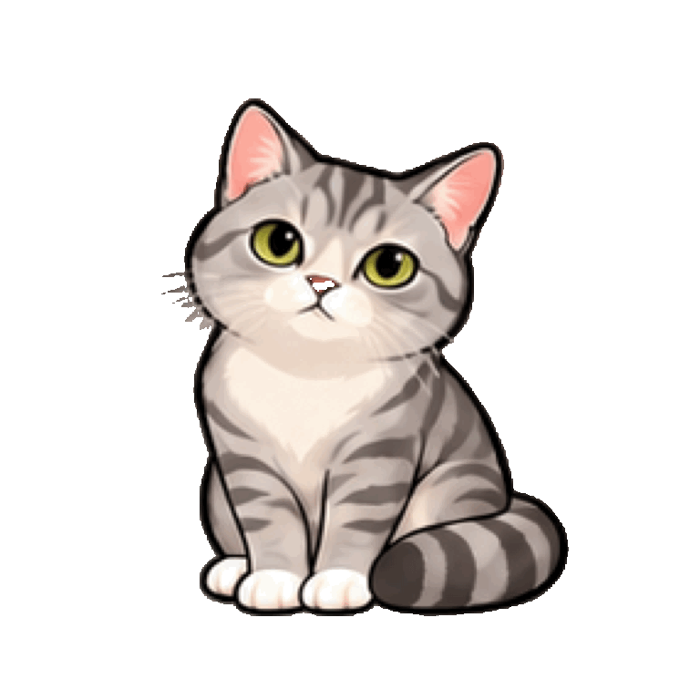
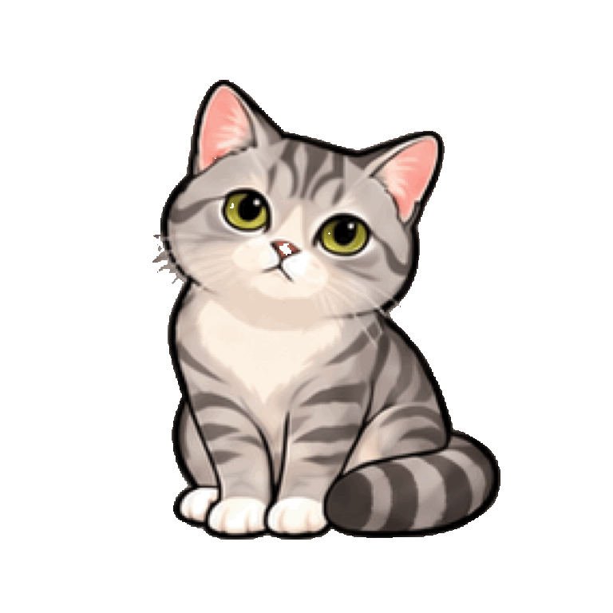
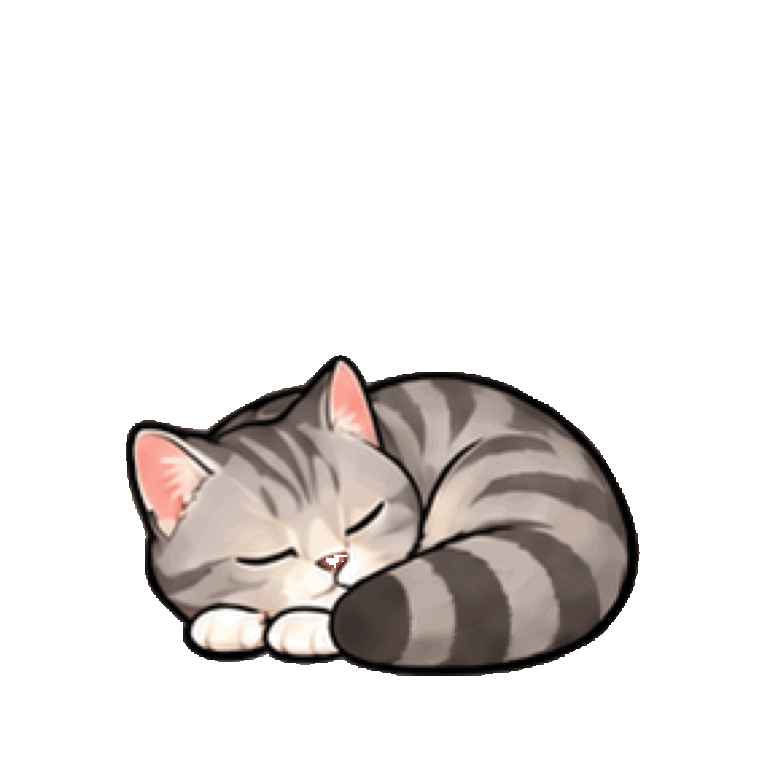

# 小猫形象与动画帧设计

日期：2026-10-23。用途：chubby-cat 桌面宠物的角色与动作设计。下方保留初始设计参数；实际播放器与 CAT-3 的当前实现以本节为准。

## CAT-3 runtime update

已实现六组动作播放器、160 ms 姿态淡化、按位移驱动的六帧行走、脚底锚点缩放和可中断的完整提醒。空闲时先静坐，再间歇观察、伸懒腰，长时间安静后打盹；不会自行乱走。聊天、拖动、提醒、手动预览和正式休息优先；隐藏、暂停、安静模式或屏幕会话不可用时停止空闲行为。打盹不表示用户已经休息。

实际时序以 `Sources/ChubbyCatCore/CatAnimation.swift` 为唯一运行时来源：idle 6.01 秒循环；walk 预览 0.75 秒，移动时按每个体型宽度 0.72 倍的距离完成一轮；stretch 2.01 秒单次；think 3.02 秒；talk 1.66 秒；sleep 4.8 秒。空闲行为按 220 秒周期，20/95/140 秒附近短暂观察，60 秒附近伸展，180 秒后打盹。行为每秒检查，伸展保留 4 秒窗口以确保单次动作完整播放。它是可调的固定节奏，尚无随机行为系统。

应用或 macOS 的“减少动态效果”变更会立即中断正在移动的提醒、回位并显示静止坐姿；下一次提醒只显示气泡。休息倒计时及提醒计时不由姿态动画控制。

### 素材、导出与验收边界

- 新行走源稿：`assets/cat/walk-cycle-v4.png`，实际 1536 × 1024，3 列 × 2 行，每个源单元 512px；有真实透明 alpha。逐帧目检为四肢结构，远侧腿可被遮挡，没有沿用旧的重复抬爪。
- 其余五组来自 `animation-keyframes-v3.png`，约 200px 原始姿态细节。原图保留，未声称完成全套 Retina 重绘。
- 运行时：`Sources/ChubbyCat/Resources/cat-frames/`，36 张 768 × 768 PNG 加 `index.json`。旧源稿按显式坐标裁切；离线清理低 alpha 与离散彩色杂点，保留白胸、白爪和鼻色。统一比例、轮廓重心及距底部 12% 的脚底基线；行走按耳尖至地面的身体高度匹配，避免抬高的尾巴把身体缩小。
- AppKit 窗口使用整数逻辑点，缩放原点显式四舍五入，原生检查容许脚底误差不超过 0.5 点。基于轮廓的导出不能消除源画本身的全部比例变化；最终精修仍需逐帧复查。
- 所有预览由实际导出的帧生成；GIF 为循环检视，App 中伸展只播放一次。1.8× 放大下另外五组清晰度仍待验收，CAT-3 保持 In Progress。

在 repo 根目录重新生成：

```bash
bash scripts/export-cat-frames.sh
bash scripts/build-app.sh
```

脚本默认使用 v4 行走稿；可向脚本传入另一张等分 3×2 行走稿路径。修改导出器后同时刷新运行时帧和下列预览，不要只替换 GIF。








[36 帧对照图](images/animation/contact-sheet.png)。动作源稿和生成提示词见 `assets/cat/prompts.md`。

## 角色依据

使用用户提供的 8 张同一只猫的照片作为形象依据。主要识别特征：银灰色短毛与深灰虎斑、额头 M 纹、圆脸与饱满腮部、黄绿色眼睛、带深色轮廓的粉鼻、浅色嘴套、白胸口、白手套、带环纹的粗尾巴、粉色耳内。

卡通化方向：保留成年猫敦实、略认真又好奇的神情，适度放大头和眼睛；采用轮廓清楚的 2D 卡通画法，减少细毛与零碎纹理，优先保证桌面 96–128 逻辑点尺寸的识别性。不增加项圈、服装或其他配件。

用户已明确采用这只猫；具体卡通画法为本次设计建议。

## 角色资源

- `assets/cat/character-model-v1.png`：最初的多角度角色探索，供体型和花纹参考，不作为最终动画画法。
- `assets/cat/character-master-v1.png`：简化卡通主形象，后续动作以它为一致性参考。
- `assets/cat/animation-keyframes-v3.png`：六组动作、每组六帧的当前设计图；修正思考动作的重复肢体，改为歪头、眨眼，双前爪保持落地。
- `assets/cat/animation-keyframes-v2.png`：上一版透明背景清理稿；思考行第 4、5 帧存在重复肢体，已由 v3 替代。
- `assets/cat/animation-keyframes-v1.png`：保留首次生成的动作设计稿，供对照。
- `assets/cat/prompts.md`：本轮内置图像生成工具使用的实际提示词记录。
- `assets/cat/animation-spec.json`：六组动作的帧数、时序与导出目标；明确标记为设计数据，尚非可直接裁切的运行时图集。

以上是美术源稿路径。主形象为 1145 × 1374 像素，动作设计图为 1254 × 1254 像素 RGBA PNG，目视检查为六行、每行六个姿态。行距与姿态边界不是严格均匀的运行时网格，不可直接按六等分裁切。生成式关键帧不默认视为已经逐帧对齐的运行时图集，边缘晕色仍需在正式导出时精修。

## 动画分组与时序

每组按 01 → 06 播放。下列帧数与时长是动画设计参数，而非已经测得的播放结果。

### 第 1 行：idle，呼吸与眨眼

01 自然坐姿睁眼；02 眼睑落下；03 完全闭眼；04 重新睁眼；05 胸口轻微起伏与尾尖摆动；06 回到自然坐姿。

- 帧停留时间：1800、120、100、120、400、1460 ms，合计 4 秒，循环。
- 常态只轻微呼吸；实际运行时在约 4–8 秒范围内随机延迟下一次眨眼，避免机械感。
- 不通过整体上下跳动模拟呼吸，爪子尽量固定。

### 第 2 行：walk-right，朝右行走

01 前后腿第一接触位；02 重心承接；03 四肢经过中间；04 对侧接触位；05 对侧承接；06 回到下一次接触前的经过位。

- 六帧各 125 ms，约 8 fps，循环；走路时持续播放，不只切换两张姿势。
- 生成帧只画原地步态；屏幕中的位移由窗口坐标控制，避免图内位移与窗口位移叠加。
- 朝左采用水平镜像；保留白袜和环尾，不在左右方向之间随意改变花纹。
- 建议移动速度 250–400 逻辑点/秒，走到中央时间按实际距离计算，约 2–5 秒；回程降到 180–300 逻辑点/秒。
- 开始与停止使用缓动，步频在起步与停步阶段随速度变化，减少滑步。

### 第 3 行：stretch，伸懒腰与休息邀请

01 四爪站立；02 前爪向前；03 胸口压低；04 臀部抬高、闭眼舒展；05 缓慢收回；06 回到站立。

- 帧停留时间：160、180、240、350、200、180 ms，合计 1.31 秒，单次播放。
- 90 分钟提醒时使用；动画结束后回到自然坐姿，气泡仍可停留。
- 不把放大分别画进六帧；所有帧保持角色比例，由渲染变换统一放大到约 1.8 倍。

### 第 4 行：think，思考与等待

01 好奇坐姿；02 视线上移；03 头轻轻偏向一侧；04 保持歪头、视线回到前方；05 闭眼眨眼；06 回到开头姿态。双前爪在整个动作中保持落地，不额外绘制抬起的肢体。

- 六帧各约 250 ms，约 1.5 秒一轮；动作之间可停留，不必连续高速循环。
- API 请求发出后播放，收到首段回答切到 talk；失败或取消回到 idle。
- 不在图片里画省略号或文字，界面自行显示状态。

### 第 5 行：talk，轻声回应

01 闭嘴；02 小幅张嘴；03 略大张嘴；04 缩小开口；05 轻微点头；06 闭嘴恢复。

- 六帧各约 140 ms，约 0.84 秒一轮。
- 有文字持续输出时低频播放，间隔穿插 idle，避免不停张嘴；生成结束后回到 idle。
- 首版是文字回复的视觉反馈，不承诺语音口型同步。

### 第 6 行：sleep，打盹

01 蜷卧闭眼；02 胸腹轻微吸气；03 呼气；04 耳朵轻动；05 尾尖轻动；06 回到 01 附近的姿态。

- 六帧各约 500 ms，约 3 秒一轮，可加入静止停留。
- 从坐姿进入或退出卧姿采用约 120–180 ms 短淡化过渡；不会直接把两个跨度很大的姿势当成连续步态。
- 打盹是陪伴表现，不代表用户完成了休息，也不改变护眼计时。

## 90 分钟提醒的组合动画

1. 保存猫的屏幕、位置和当前动作状态。
2. 切到对应方向的 walk，向当前显示器可用区域中央移动。
3. 停步，约 0.5 秒放大到 1.8 倍，以爪底锚点稳定缩放。
4. 播放一次 stretch，接回 idle；显示固定休息提醒文案与按钮。
5. 用户选择或气泡停留约 6–8 秒后，约 0.4 秒缩回正常大小。
6. 用较慢的 walk 回到原坐标，再切回 idle。

放大、移动、气泡和角色序列帧分别控制。用户拖动、打开问答、锁屏或拔掉显示器时，协调器可中断流程并恢复有效状态。动画本身不抢键盘焦点。

## 运行时资源整理规范

- 建议每个动作使用独立透明 PNG 帧序列，命名如 `idle/idle_01.png`、`walk-right/walk-right_01.png`；需要时再打包图集。
- 初始目标画布：每帧 512 × 512 像素，用于最高约 230 逻辑点的 Retina 放大显示；最终依据显示尺寸与清晰度实测调整。
- 所有动作统一画布、角色比例和地面基线，爪底锚点建议为画布宽度 50%、高度 88% 处；逐帧校正位置，不独立紧裁导致抖动。
- 身体和尾巴都需预留边距；伸懒腰的横向展开范围也要放得下。
- 资源保留真实 alpha；白胸和白爪不能当成背景抠除，不添加烘焙地面阴影。
- 虎斑数量、眼睛颜色、尾环和白袜边界保持稳定，不能在帧间变换成不同猫。
- 动作帧的时序记录独立于图片，便于调整停留时长和减少动态效果。
- 减少动态效果开启时，使用单张 idle 与气泡淡入；跳过跨屏幕行走及大幅缩放。

## 美术验收

- [ ] 96、128 逻辑点预览时，仍能辨认黄绿色眼睛、白胸与白袜、额头虎斑。
- [ ] 动作设计图每行恰有六个独立姿态，顺序明确，耳朵、尾巴和爪子没有被裁掉。
- [ ] 六组动作属于同一画法和同一角色，没有明显多肢、消失的爪子或花纹漂移。
- [ ] 正式导出前逐帧校准统一尺寸、脚底位置、alpha 边缘，清除脏点和晕边。
- [ ] 将帧串成循环预览检查行走节奏、起止过渡、呼吸幅度，不能只检查静态图。
- [ ] 提醒中的 1.8 倍显示保持清晰，缩放不被误当作一套独立逐帧动画。

当前交付定位：角色形象和动画关键帧设计。逐帧精修、对齐、运行时导出及播放器整合属于下一步实现工作。
